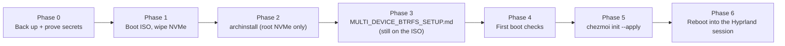

# Desktop Reinstall: ISO to Dotfiles

## Overview

Reinstall Arch Linux on the **desktop** (RTX 4090, no iGPU, several disks) and bootstrap this repository on it.

> **Status**: archinstall steps come from the **archinstall 4.5 source** (tag 4.5, 2026-09-29), not from a live run. Menu labels can differ on the ISO you boot: **verify each label on screen** and treat anything marked *(unverified)* as a lead, not a fact. **Not tested on hardware.**

End state: LUKS2 root + extra LUKS2 disks in one BTRFS pool, systemd-boot UKI, Hyprland + Quickshell via this repo.



| Phase | Where | What |
|-------|-------|------|
| 0 | Old system + other machine | Back up, prove vault and SSH access |
| 1-2 | Arch ISO | archinstall on the root NVMe only |
| 3 | Arch ISO (`/mnt` still mounted) | Extra disks, crypttab, sd-encrypt, UKI (separate guide) |
| 4-6 | New system | Verify, dotfiles bootstrap, first session |

## Phase 0: Before wiping (mandatory)

**This is irreversible.** The current BTRFS pool spans the root disk and the extra disks. Reinstalling the root disk destroys the **whole** filesystem, including the data on the extra disks and every Timeshift snapshot (they live on the same pool).

### 0.1 Back up off-machine

- `~` (documents, projects, browser profiles, game saves)
- Anything under `/etc` you customised
- Your Vaultwarden export is **not** a backup of this machine: it only holds secrets

### 0.2 Capture the values `chezmoi init` will ask for

On the **old** machine:

```bash
chezmoi data | jaq '{fullname, workEmail, personalEmail, privateServer, ovhKS5ServerIP, ovhVPSServerIP}'
```

Write them down: the reinstall asks for the same six answers.

### 0.3 Prove the secret path works from another machine

Script `run_once_before_005_instantiate_encryption_key.sh.tmpl` fetches `~/.keys/dotfiles-key.txt` from Vaultwarden, and scripts 004/999 need the GitLab SSH key. Check both **before** wiping:

```bash
rbw get dotfiles-key | head -c 20; echo     # must print the start of an AGE-SECRET-KEY
ssh -T git@gitlab.com                        # must greet you
```

If either fails, fix it first. Fallback: copy `~/.keys/dotfiles-key.txt` to a USB stick (mode 600 afterwards).

### 0.4 Identify the disks by serial

```bash
lsblk -o NAME,SIZE,MODEL,SERIAL,FSTYPE,MOUNTPOINTS
ls -l /dev/disk/by-id/
```

Write down which disk is the root NVMe and which are the extras. You will pick the root disk by **serial** in archinstall.

### 0.5 Prepare the stick

- Download the current Arch ISO, write it to a USB stick, boot with **Secure Boot off** (this repo has no sbctl flow).
- Write the ISO with `dd` (`dd if=archlinux-*.iso of=/dev/sdX bs=4M status=progress oflag=sync`), not Ventoy: Ventoy 1.1.18 and a direct write both stalled here, so the stick type is not the cause, but one fewer loader is one fewer variable. Verify first with `sha256sum` against archlinux.org.
- **The live ISO hangs on the RTX 4090** (cursor stops blinking after `Failed to register i2c client ...`, which is a harmless warning): nouveau stalls on the Ada GPU. At the systemd-boot menu press `e` and append `nomodeset module_blacklist=nouveau` to the options, then Enter. `nomodeset` alone is not enough. This affects only the live session; the installed system uses `nvidia-open`.
- Keep the stick and a second copy of the Phase 0 notes available offline.

## Phase 1: Boot the ISO

```bash
loadkeys <your-layout>            # if not US
ping -c1 archlinux.org            # Ethernet works out of the box; Wi-Fi: iwctl
timedatectl                       # NTP active
lsblk -o NAME,SIZE,MODEL,SERIAL,FSTYPE
```

Optional: `pacman -Sy archinstall` to get the newest archinstall (the Arch Wiki says this is fine). The rest of this guide targets 4.5.

### 1.1 Wipe the root NVMe

Identify it by serial, then:

```bash
ls /dev/mapper                    # must not list "root" (collides with archinstall's fixed mapper name)
wipefs -a /dev/disk/by-id/nvme-ROOT-SERIAL
```

Stale BTRFS signatures from the old install have crashed manual partitioning before (issue #4299). **Do not touch the extra disks here:** the multi-device guide wipes them in Phase 3.

### 1.2 Verify the wipe

```bash
partprobe /dev/disk/by-id/nvme-ROOT-SERIAL    # make the kernel drop the old partitions
wipefs /dev/disk/by-id/nvme-ROOT-SERIAL       # list mode: must print nothing
lsblk -f /dev/disk/by-id/nvme-ROOT-SERIAL     # only the disk line, no child partitions
```

**Expected**: `wipefs` prints nothing and `lsblk` shows no partitions or filesystems under the root NVMe. If a partition or signature is still listed, re-run `wipefs -a` on it (partition first, then the disk). The old partitions are still mounted or in use (`findmnt`, `cryptsetup close root`) if the wipe fails with "Device or resource busy". Check the serial in the path against Phase 0.4 once more: this must be the root NVMe and no extra disk.

## Phase 2: archinstall

Start it with `archinstall`. It opens a menu prefilled with defaults. Work **top to bottom as written**, because two menus reset other menus:

- Changing *Partitioning* resets *Disk encryption*. Set encryption **last**.
- Re-entering *Profile → Type* resets *Graphics driver* and *Greeter*. Set **Type, then driver, then greeter**, and never go back into Type.

### 2.1 Settings

| Menu (4.5 label) | Choice |
|---|---|
| Archinstall language | Any |
| Locales | Keyboard layout, locale language/encoding, console font as you prefer |
| Mirrors and repositories | Select your region explicitly (4.5 no longer waits for reflector) |
| **Disk configuration → Partitioning** | See 2.2 |
| Swap | Yes, zram, algorithm `zstd` |
| Bootloader | **Systemd-boot**, **Unified kernel images: on**, removable location: off, Plymouth: **off** (the dotfiles install it later) |
| Kernels | `linux` **and** `linux-lts` (`packages.yaml` expects both; the LTS UKI is your fallback entry) |
| Additional firmware | None needed |
| Hostname | As you like |
| Authentication | User account with **superuser (sudo): yes**. Root password optional if a sudo user exists |
| **Profile** | See 2.3 |
| **Applications** | Audio: **pipewire** |
| Network configuration | **Use Network Manager (default backend)** |
| Pacman | Defaults (parallel downloads under `--advanced`) |
| **Additional packages** | `git jq rbw rage-encryption nvidia-open nvidia-open-lts libva-nvidia-driver` |
| Timezone / Automatic time sync | Your zone; NTP on |
| **Disk configuration → Disk encryption** | **Last.** See 2.4 |

`git`, `jq`, `rbw` and `rage-encryption` make the chezmoi pre-hook (`.scripts/install-password-manager-and-encryption.sh`) a no-op on first apply.

### 2.2 Disk configuration

1. *Partitioning* → "Use a best-effort default partition layout". The Disk configuration submenu in 4.5 also lists **Btrfs snapshots**, **LVM** and **Disk encryption**; skip all three here (Btrfs snapshots writes snapshot config that you'd undo later, LVM is not used, Disk encryption is set last in 2.4).
2. *Select disks*: the table is **multi-select**. Mark **only the root NVMe**. Marking two disks makes archinstall wipe **both** (root on one, `/home` on the other).
3. Filesystem: **btrfs**.
4. "Would you like to use BTRFS subvolumes with a default structure?": **yes**.
5. "Would you like to use compression or disable CoW?": **Use compression** (`compress=zstd`; the level is not selectable).

Result: ESP 1 GiB FAT32 at `/boot`, the rest btrfs with subvolumes `@` (`/`), `@home`, `@log` (`/var/log`), `@pkg` (`/var/cache/pacman/pkg`).

**Add `@tmp`** (not in the default set): *Partitioning* → *Manual Partitioning* → select the btrfs partition → *Set subvolumes* → *Add subvolume* → name `@tmp`, mountpoint `/var/tmp`. Choosing Manual after Default reuses the default layout as its starting point. *(unverified in the TUI)*

Do **not** add `@swap` (swap is zram; script 006 skips hibernation on any `/dev/mapper` root) or `@.snapshots` (Timeshift needs top-level `@` and `@home`).

### 2.3 Profile

1. *Profile → Type*: **Desktop**, then pick **Hyprland**.
2. Seat access prompt: **`systemd-logind`** (4.5 makes you pick; `seatd` would add a service and a `seat` group).
3. *Graphics driver*: set it to **no driver**. Do not pick "Nvidia (open kernel module…)": with `linux-lts` in the kernel list it installs `nvidia-open-dkms` (+ `dkms` + headers) instead of the `nvidia-open` / `nvidia-open-lts` packages that `.chezmoidata/packages.yaml` declares; script `001_preflight_and_session_validation` will then swap `nvidia-open-dkms` for `nvidia-open` / `nvidia-open-lts` on first apply (the two conflict, so package sync would abort otherwise), and the orphan cleanup drops `dkms` and the headers, but the extra churn slows the bootstrap. The prebuilt packages are added by hand in 2.1. Also avoid the "All open-source" default: it installs nouveau and Intel/AMD userspace. (The exact way to blank the driver in the TUI is *(unverified)*; the JSON route, `"gfx_driver": null`, is certain: see Appendix A.)
4. *Greeter*: **sddm**. sddm requires a regular user (step in 2.1).

### 2.4 Disk encryption (last)

*Disk encryption* → type **LUKS** → set the encryption password → **Iteration time: 2000** (default 10000 ms is about 10 s per unlock) → select the **root partition** (not `/boot`). Skip HSM (FIDO2 only; there is no TPM option).

If the password or the partition list is empty the menu silently returns "no encryption". After closing it, confirm the *Disk configuration* preview shows LUKS.

### 2.5 Review, save, install

1. *Save configuration* → pick a directory (a USB stick if you want to reuse it: Appendix A).
2. *Install*.
3. When "What would you like to do next?" appears choose **Exit archinstall**. **Not** "Reboot system". **Not** "chroot into installation for post-installation configurations": Phase 3 starts outside the chroot because it needs the ISO shell variables.

### 2.6 State to expect

Nothing is unmounted or closed:

```bash
findmnt -R /mnt
ls /dev/mapper                     # root
cat /mnt/etc/kernel/cmdline        # cryptdevice=PARTUUID=...:root root=/dev/mapper/root ... rootflags=subvol=@ ...
grep ^HOOKS /mnt/etc/mkinitcpio.conf      # busybox: ... block encrypt filesystems fsck
ls /mnt/boot/EFI/Linux/            # arch-linux.efi arch-linux-lts.efi (no fallback UKI)
```

archinstall writes busybox `encrypt` hooks, a fixed mapper name `root`, and no fallback UKI. These are what Phase 3 converts.

## Phase 3: Extra disks, crypttab, sd-encrypt (still on the ISO)

Follow **`_guides/MULTI_DEVICE_BTRFS_SETUP.md`** from Phase 1 to Phase 6 in the same ISO shell. It:

- encrypts the extra disks with keyfiles,
- writes `/etc/crypttab`, converts the hooks to `systemd` + `sd-encrypt`,
- rewrites `/etc/kernel/cmdline`, rebuilds both UKIs,
- adds the disks to BTRFS and converts metadata to raid1,
- unmounts, closes and reboots.

Come back here after the reboot. If you want a single-disk install, skip that guide: the busybox `encrypt` setup boots as is, but you lose the sd-encrypt path the dotfiles scripts anticipate (`plymouth` before `encrypt` also works).

## Phase 4: First boot checks

Enter the passphrase **once**. You land on SDDM (or a TTY if the session fails).

```bash
lsblk -f
ls /dev/mapper/                      # root cryptdisk1 ... cryptdiskN
sudo btrfs filesystem show /
findmnt -t btrfs
ls /boot/EFI/Linux/
pacman -Q nvidia-open nvidia-open-lts linux linux-lts git jq rbw rage-encryption
nvidia-smi
```

**Expected**: one prompt, all mapper devices present, both UKIs, the nvidia packages installed, `nvidia-smi` listing the 4090.

If `nvidia-smi` fails: `lsmod | grep nvidia`, `sudo dmesg | grep -i nvidia`. With the open modules the 4090 is supported; nouveau must not be loaded (`nvidia-utils` blacklists it).

Log in to a TTY (Ctrl+Alt+F2) if SDDM misbehaves: the bootstrap works from a TTY. Script `run_once_before_001_preflight_and_session_validation.sh.tmpl` only needs `XDG_RUNTIME_DIR` (provided by logind) and `sudo`.

## Phase 5: Dotfiles bootstrap

Run **from your home directory** (the chezmoi `read-source-state` pre-hook is a path relative to `~`):

```bash
cd ~
sh -c "$(curl -fsLS get.chezmoi.io)" -- -b "$HOME/.local/bin"
.local/bin/chezmoi init --apply https://gitlab.com/amoconst/dotfiles.git
```

Takes 15-45 minutes. Interactive moments:

| When | What |
|------|------|
| `chezmoi init` | Six prompts from `.chezmoi.yaml.tmpl`: `fullname`, `workEmail`, `personalEmail`, `privateServer`, `ovhKS5ServerIP`, `ovhVPSServerIP` (answers saved in Phase 0.2). **`privateServer` drives the rbw base URL** (`www` replaced by `vaultwarden`), so it must be exact |
| `sudo` | Many scripts ask for your password |
| Script 005 | `rbw login` (master password via pinentry), then it fetches the age key |
| Script 006 | Possible `gum confirm` prompts; the hibernation ones do not appear on a LUKS root |

What it does on this machine:

- `chassisType: desktop`; `nvidiaDriverType: modern` (the 4090 is not a legacy part); `hasIntegratedGpu: false`, so script 006 keeps the `kms` hook out of mkinitcpio.
- Script 001 passes: `nvidia-open` is already installed (no migration prompt).
- Script 002 installs paru, Chaotic-AUR, yq, gum.
- `run_onchange_before_sync_packages` installs everything in `packages.yaml`.
- Script 006 writes `/etc/mkinitcpio.conf.d/nvidia.conf`, installs Plymouth into HOOKS (`block plymouth sd-encrypt`), appends `splash quiet` to `/etc/kernel/cmdline`, configures SDDM + the uwsm session, then runs one `mkinitcpio -P`. Hibernation is skipped on a `/dev/mapper` root, so no swapfile is created.
- Script 004 clones the wallpapers repo over SSH; script 999 switches the git remotes to SSH.

If a script fails, fix the cause and run `chezmoi apply` again: scripts that already succeeded are not re-run.

## Phase 6: Reboot into the Hyprland session

```bash
reboot
```

At SDDM select **Hyprland (uwsm-managed)**. The plain `hyprland` session starts no bar, no idle lock and no notification daemon (the repo's user units hang off `graphical-session.target`, which only uwsm reaches).

### 6.1 Verify

```bash
chezmoi data | jaq '.nvidiaDriverType, .hasIntegratedGpu, .chassisType'    # "modern" false "desktop"
nvidia-smi
quickshell -c dotfiles ipc show
ls ~/.config/wallpapers | head -3
git -C ~/.local/share/chezmoi remote -v          # git@gitlab.com
systemctl --user --failed
grep ^HOOKS /etc/mkinitcpio.conf                  # ... block plymouth sd-encrypt filesystems fsck
cat /etc/kernel/cmdline                           # contains quiet splash, no cryptdevice=
```

Then follow `README.md` "First Run".

## Recovery

### Live-USB chroot (boot fails after Phase 3 or 5)

See `MULTI_DEVICE_BTRFS_SETUP.md`, Recovery 1. After the dotfiles apply, `mkinitcpio -P` also needs `/etc/mkinitcpio.conf.d/nvidia.conf` (do not delete it).

### `chezmoi apply` aborted midway

```bash
chezmoi diff | head
chezmoi apply
```

Read the failing script's last log lines. Typical causes: network, no vault access (Phase 0.3), the SSH key missing (004/999 only warn and skip).

### Script 001: "NVIDIA DRIVER MIGRATION DETECTED"

The installed driver does not match `nvidiaDriverType`. Check `chezmoi data | jaq .nvidiaDriverType` (should be `"modern"`), and `pacman -Q nvidia-open`. `nvidia-open-dkms` from archinstall is swapped for `nvidia-open nvidia-open-lts` automatically, without this prompt; if that swap fails, run `sudo pacman -R nvidia-open-dkms && sudo pacman -S nvidia-open nvidia-open-lts`. If detection itself is wrong, override with `NVIDIA_DRIVER_OVERRIDE=modern chezmoi apply`.

### Vault unreachable (script 005)

Copy `dotfiles-key.txt` (Phase 0.3 fallback) into `~/.keys/`, `chmod 600 ~/.keys/dotfiles-key.txt`, then `chezmoi apply`: the script skips when the key file is non-empty.

## Appendix A: archinstall JSON config

archinstall can replay a saved config: `archinstall --config user_configuration.json --creds user_credentials.json`. **Generate it from your own run**, because partition `start`/`size` are validated against the real disk and `obj_id` ties the encryption block to the root partition.

1. Do Phase 2 once in the TUI and choose *Save configuration* (or take `/var/log/archinstall/user_configuration.json`).
2. `archinstall --dry-run` stops right after saving.
3. Edit the saved file as needed, keep it somewhere safe. Never keep `user_credentials.json` in the repo.

Trimmed template (take sizes and `obj_id` values from your saved file):

```json
{
  "disk_config": {
    "config_type": "manual_partitioning",
    "device_modifications": [{
      "device": "/dev/nvme0n1", "wipe": true,
      "partitions": [
        {"obj_id": "<uuid-esp>", "status": "create", "type": "primary",
         "start": {"value": 1, "unit": "MiB", "sector_size": {"value": 512, "unit": "B"}},
         "size":  {"value": 1, "unit": "GiB", "sector_size": {"value": 512, "unit": "B"}},
         "fs_type": "fat32", "mountpoint": "/boot", "mount_options": [],
         "flags": ["boot", "esp"], "dev_path": null, "btrfs": []},
        {"obj_id": "<uuid-root>", "status": "create", "type": "primary",
         "start": {"value": 1025, "unit": "MiB", "sector_size": {"value": 512, "unit": "B"}},
         "size":  {"value": "<from saved config>", "unit": "B", "sector_size": {"value": 512, "unit": "B"}},
         "fs_type": "btrfs", "mountpoint": null, "mount_options": ["compress=zstd"],
         "flags": [], "dev_path": null,
         "btrfs": [{"name": "@", "mountpoint": "/"}, {"name": "@home", "mountpoint": "/home"},
                   {"name": "@log", "mountpoint": "/var/log"},
                   {"name": "@pkg", "mountpoint": "/var/cache/pacman/pkg"},
                   {"name": "@tmp", "mountpoint": "/var/tmp"}]}
      ]}],
    "disk_encryption": {"encryption_type": "luks", "partitions": ["<uuid-root>"], "iter_time": 2000},
    "btrfs_options": {"snapshot_config": null}
  },
  "bootloader_config": {"bootloader": "Systemd-boot", "uki": true, "removable": false},
  "swap": {"enabled": true, "algorithm": "zstd"},
  "kernels": ["linux", "linux-lts"],
  "profile_config": {
    "profile": {"main": "Desktop", "details": ["Hyprland"],
                "custom_settings": {"Hyprland": {"seat_access": "systemd-logind"}}},
    "gfx_driver": null, "greeter": "sddm"},
  "app_config": {"audio_config": {"audio": "pipewire"}},
  "network_config": {"type": "nm"},
  "packages": ["git", "jq", "rbw", "rage-encryption", "nvidia-open", "nvidia-open-lts", "libva-nvidia-driver"],
  "hostname": "myhost", "timezone": "Europe/Paris", "ntp": true,
  "locale_config": {"kb_layout": "us", "sys_lang": "en_US.UTF-8", "sys_enc": "UTF-8"}
}
```

`user_credentials.json`:

```json
{"encryption_password": "...", "users": [{"username": "you", "!password": "...", "sudo": true, "groups": []}]}
```

Notes:
- `iter_time` inside `disk_encryption` is the TUI value in milliseconds; the TUI field is the same key.
- `"device"` is a path; NVMe numbering can change between boots. Re-check with `lsblk -o NAME,SIZE,MODEL,SERIAL` before running.
- Flags: `--config`, `--creds`, `--silent`, `--dry-run`, `--skip-ntp`, `--offline`, `--advanced`. **Caveat**: `--silent` is silently disabled unless `--config`/`--config-url` is also passed. Without `--silent` the menu opens prefilled for review.

## Known archinstall pitfalls (4.5)

- Two disks marked in the table: both are wiped.
- Stale BTRFS signatures or an open `/dev/mapper/root`: wipe the NVMe and `cryptsetup close root` first.
- Encryption silently dropped when the password or partition list is empty; re-editing Partitioning clears it.
- Graphics driver reset by re-entering Profile → Type (#4455).
- ISO 2026.10.01 reports hangs on time/keyring sync (#4838): try `--skip-ntp`, then check mirrors.
- archinstall does nothing NVIDIA-specific beyond packages: no `MODULES`, no `nvidia_drm` options (the dotfiles do that).

## References

- `_guides/MULTI_DEVICE_BTRFS_SETUP.md` (Phase 3)
- `README.md` (Installation, First Run)
- [archinstall repository](https://github.com/archlinux/archinstall), [Arch Wiki: Archinstall](https://wiki.archlinux.org/title/Archinstall)
- `.chezmoiscripts/run_once_before_00{0..7}_*`, `run_once_after_006_configure_boot_system.sh.tmpl`
