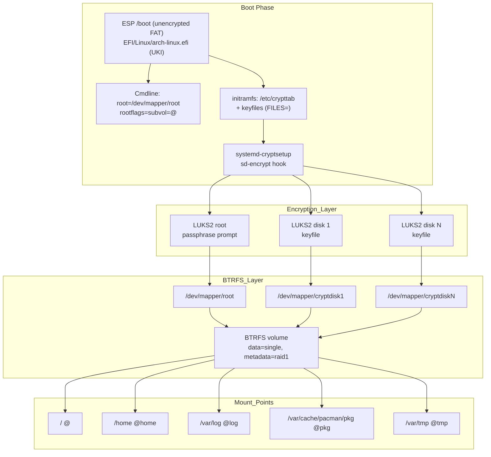

# Multi-Device Encrypted BTRFS Setup

## Overview

Spread one encrypted BTRFS filesystem across the root NVMe and several extra disks, unlocked with a **single passphrase prompt** at boot.

Run it **from the Arch ISO, right after `archinstall` and before the first boot**. It is the middle step of `DESKTOP_REINSTALL.md` (Phase 3).

- **Root disk**: LUKS2, manual passphrase
- **Extra disks**: LUKS2, random keyfile embedded in the UKI, no prompt
- **Filesystem**: BTRFS, `data=single`, `metadata=raid1` (converted after the last `device add`)
- **Boot method**: UKI (systemd-boot) with the `systemd` + `sd-encrypt` initramfs hooks
- **Unlock config**: `/etc/crypttab` with `x-initrd.attach`, kernel cmdline in `/etc/kernel/cmdline`

> **Status**: written from the Arch Wiki, man pages and source (mkinitcpio 42.2, systemd 262, cryptsetup 2.8, btrfs-progs 7.1). **Not yet tested end to end on hardware.** Items marked *(unverified)* are inferred. Read `Security note` before choosing this design.

## Architecture



## Security note (read first)

The keyfiles of the extra disks are embedded in the UKI, and the UKI lives on the **unencrypted EFI System Partition**. Anyone who can read the ESP (a thief with the machine, someone booting a live USB, or any local user if the ESP is mounted world-readable) can extract those keys and decrypt the extra disks **without your passphrase**.

- The root NVMe stays protected by its passphrase.
- BTRFS keeps `data=single`, so a large share of your files is on the extra disks. With `metadata=raid1`, a copy of file names and directory structure is there too.
- Secure Boot does not change this: it proves the UKI was not tampered with, it does not hide what is inside.
- The Arch Wiki advises embedding keyfiles only if `/boot` is encrypted or authentication happens earlier in the boot. Neither applies to systemd-boot + UKI.

This guide uses keyfiles anyway because they are random (not brute-forceable) and let you change the passphrase without touching the data disks. If the ESP exposure is not acceptable, apply **Phase 7 (hardening)**: it removes the keyfiles from the UKI and unlocks the extra disks with the root passphrase (still one prompt).

Changing a passphrase later does **not** revoke old header backups or disk images: only `cryptsetup reencrypt` changes the volume key.

## Prerequisites

- `archinstall` finished (`DESKTOP_REINSTALL.md`, Phase 2), **still in the ISO shell**:
  - `/mnt` mounted, root LUKS open as `/dev/mapper/root`
  - archinstall's busybox `encrypt` hook and `cryptdevice=` cmdline still in place (this guide converts them)
- 1+ additional disks, **their contents will be destroyed**
- Network on the ISO (`cryptsetup`, `btrfs-progs`, `mkinitcpio` are already on the ISO or in `/mnt`)

Use `/dev/disk/by-id/...` paths for disks, never `/dev/sdX`: the letters change between boots.

## Phase 1: Verify the starting state

```bash
findmnt -R /mnt
ls /dev/mapper
lsblk -o NAME,SIZE,MODEL,SERIAL,FSTYPE
grep -E '/boot' /mnt/etc/fstab
cat /mnt/etc/kernel/cmdline
```

**Expected**:
- `findmnt` shows `@` on `/mnt` plus `/mnt/home`, `/mnt/var/log`, `/mnt/var/cache/pacman/pkg`, `/mnt/var/tmp`, and the ESP on `/mnt/boot`.
- `/dev/mapper/root` exists.
- The cmdline holds `cryptdevice=PARTUUID=...:root root=/dev/mapper/root`.
- The `/boot` fstab line has `fmask=0177,dmask=0077`. If it says `0022`, edit it now: the UKI would otherwise be world-readable on a running system.

Define the disks once. All later phases reuse these variables, so stay in the same shell.

```bash
DISKS=(
  /dev/disk/by-id/ata-DISK1-SERIAL
  /dev/disk/by-id/ata-DISK2-SERIAL
  /dev/disk/by-id/nvme-DISK3-SERIAL
)
ROOT_PART=$(cryptsetup status root | awk '/device:/ {print $2}')
echo "$ROOT_PART"; printf '%s\n' "${DISKS[@]}"
```

Check that `ROOT_PART` is the root partition and that **none** of `DISKS` is the root NVMe.

## Phase 2: Wipe, key and encrypt the extra disks

### 2.1 Wipe

```bash
for d in "${DISKS[@]}"; do wipefs -a "$d"; done
```

### 2.2 Generate keyfiles

Filenames must be `cryptdiskN.key`: systemd looks up `/etc/cryptsetup-keys.d/<mapper-name>.key` by itself when the crypttab key column is empty or `none`. This guide still writes the full path in crypttab.

```bash
install -d -m 0700 /mnt/etc/cryptsetup-keys.d
n=0
for d in "${DISKS[@]}"; do
  n=$((n+1))
  ( umask 077; dd if=/dev/urandom of=/mnt/etc/cryptsetup-keys.d/cryptdisk$n.key bs=4096 count=1 )
done
ls -l /mnt/etc/cryptsetup-keys.d/
```

**Do not create a key for the root disk.** Root uses the passphrase only.

### 2.3 Format

The keyfile is 4096 random bytes, so a slow KDF protects nothing and only adds boot time. Use `pbkdf2` with the minimum 1000 iterations (libcryptsetup rejects fewer).

```bash
n=0
for d in "${DISKS[@]}"; do
  n=$((n+1))
  cryptsetup luksFormat --type luks2 --cipher aes-xts-plain64 --key-size 512 \
    --pbkdf pbkdf2 --pbkdf-force-iterations 1000 --hash sha512 \
    --key-file /mnt/etc/cryptsetup-keys.d/cryptdisk$n.key "$d"
done
```

### 2.4 Open and verify

```bash
n=0
for d in "${DISKS[@]}"; do
  n=$((n+1))
  cryptsetup open --key-file /mnt/etc/cryptsetup-keys.d/cryptdisk$n.key "$d" cryptdisk$n
done
ls /dev/mapper
```

**Expected**: `root`, `cryptdisk1` ... `cryptdiskN`.

### 2.5 Back up keys and headers

Do this **now**, before the disks hold data. A lost keyfile with no other keyslot means that disk is gone for good.

```bash
# Headers: tmpfs without swap, encrypt before leaving the machine
mkdir -p /root/bk && mount -t tmpfs -o size=64m,noswap tmpfs /root/bk
cryptsetup luksHeaderBackup "$ROOT_PART" --header-backup-file /root/bk/root.hdr
n=0
for d in "${DISKS[@]}"; do
  n=$((n+1))
  cryptsetup luksHeaderBackup "$d" --header-backup-file /root/bk/cryptdisk$n.hdr
  base64 -w0 /mnt/etc/cryptsetup-keys.d/cryptdisk$n.key > /root/bk/cryptdisk$n.key.b64
done
tar -C /root/bk -cf - . | gpg --symmetric --cipher-algo AES256 -o /root/luks-backup.tar.gpg
```

Copy `/root/luks-backup.tar.gpg` to another machine or USB stick (`scp`, `mount` a stick). Then keep the keyfiles as base64 **secure notes** in Vaultwarden (4096 bytes ≈ 5464 characters; `rbw`'s attachment support is *unverified*, so use a note). Never store the backup on the same disk.

A restored header **re-enables every keyslot it had**: old passphrases come back. Re-run the backup after each key change and destroy the old copies.

## Phase 3: Unlock configuration

### 3.1 `/etc/crypttab`

Use `/etc/crypttab` with `x-initrd.attach` for root **and every member**. Do not use `/etc/crypttab.initramfs` (deprecated, and ignored when mixed) and do not put `rd.luks.*` on the cmdline: if any `rd.luks.*` parameter exists, only the UUIDs named there are activated from crypttab.

`discard` passes TRIM through LUKS. It leaks which blocks are free (usage pattern, filesystem type); keep it on SSDs/NVMe unless that matters to you.

```bash
{
  printf 'root UUID=%s none discard,x-initrd.attach\n' "$(cryptsetup luksUUID "$ROOT_PART")"
  n=0
  for d in "${DISKS[@]}"; do
    n=$((n+1))
    printf 'cryptdisk%s UUID=%s /etc/cryptsetup-keys.d/cryptdisk%s.key discard,x-initrd.attach\n' \
      "$n" "$(cryptsetup luksUUID "$d")" "$n"
  done
} > /mnt/etc/crypttab
cat /mnt/etc/crypttab
```

The UUIDs are the **LUKS container UUIDs** (`cryptsetup luksUUID`), not PARTUUID and not the BTRFS UUID.

Never add `nofail` to a BTRFS member: the mount fails anyway without it, and the passphrase prompt can disappear.

### 3.2 mkinitcpio

```bash
cp /mnt/etc/mkinitcpio.conf /mnt/etc/mkinitcpio.conf.archinstall
sed -i -E 's/^HOOKS=.*/HOOKS=(base systemd autodetect microcode modconf keyboard sd-vconsole block sd-encrypt filesystems fsck)/' /mnt/etc/mkinitcpio.conf
files=$(for i in $(seq 1 ${#DISKS[@]}); do printf '/etc/cryptsetup-keys.d/cryptdisk%s.key ' "$i"; done)
sed -i -E "s|^FILES=.*|FILES=(${files% })|" /mnt/etc/mkinitcpio.conf
grep -E '^(HOOKS|FILES)=' /mnt/etc/mkinitcpio.conf
```

Why these hooks:
- `systemd` + `sd-vconsole` replace busybox `udev` + `keymap consolefont`.
- `sd-encrypt` replaces `encrypt`.
- No `btrfs` hook: the `systemd` hook already ships the udev rule that waits for all BTRFS members.
- No `kms` and no `plymouth`: the desktop has no iGPU, and Plymouth is not installed yet. The dotfiles script `run_once_after_006_configure_boot_system.sh.tmpl` inserts `plymouth` before `sd-encrypt` later, which works because `block sd-encrypt` stay adjacent.
- `FILES=` is required: `sd-encrypt` copies only crypttab, never the keyfiles it references.

### 3.3 Kernel cmdline: one source only

mkinitcpio 42 **concatenates** `/etc/kernel/cmdline` and every `/etc/cmdline.d/*.conf`. Use `/etc/kernel/cmdline` alone (archinstall and `006` both use it) and do not create `cmdline.d`.

```bash
cp /mnt/etc/kernel/cmdline /mnt/etc/kernel/cmdline.archinstall
echo 'root=/dev/mapper/root rootflags=subvol=@ rw rootfstype=btrfs zswap.enabled=0' > /mnt/etc/kernel/cmdline
cat /mnt/etc/kernel/cmdline
```

`cryptdevice=` is gone (busybox-only). `006` appends `quiet splash` later; it rolls back from `cmdline.backup`, so keep this file as the source of truth.

### 3.4 Boot loader default

```bash
cat /mnt/boot/loader/loader.conf
```

It should contain `default arch-linux.efi`. If the line is missing, add it:

```bash
echo 'default arch-linux.efi' >> /mnt/boot/loader/loader.conf
```

archinstall builds `arch-linux.efi` and `arch-linux-lts.efi` but **no fallback UKI**. The LTS UKI is your fallback entry.

## Phase 4: Rebuild the UKIs

```bash
arch-chroot /mnt mkinitcpio -P
```

**Expected**:
- No `Hook ... cannot be found` errors.
- A line like `Using cmdline file: /etc/kernel/cmdline` for each preset. If you also see `/etc/cmdline.d/...`, delete that directory's files.
- Both `/boot/EFI/Linux/arch-linux.efi` and `arch-linux-lts.efi` are written.

### 4.1 Verify

```bash
ls -l /mnt/boot/EFI/Linux/
arch-chroot /mnt lsinitcpio /boot/EFI/Linux/arch-linux.efi | grep -E 'cryptsetup-keys|crypttab'
arch-chroot /mnt lsinitcpio /boot/EFI/Linux/arch-linux-lts.efi | grep -E 'cryptsetup-keys|crypttab'
```

**Expected**: `cryptdisk1.key` ... `cryptdiskN.key` and `etc/crypttab` listed in **both** UKIs; **no** `root.key`. `lsinitcpio` reading a UKI is *unverified*; if it refuses, `mkinitcpio -P` output (the `==> ... Including file` lines) is the fallback evidence.

## Phase 5: Add the disks to BTRFS

Still in the ISO shell, the filesystem is mounted at `/mnt`.

```bash
n=0
for d in "${DISKS[@]}"; do
  n=$((n+1))
  btrfs device add /dev/mapper/cryptdisk$n /mnt
done
btrfs filesystem show /mnt
```

**Expected**: `Total devices N+1` with the root mapper plus every `cryptdiskN`.

### 5.1 Convert metadata to raid1

`device add` keeps the existing profiles, so metadata stays **DUP**, and both DUP copies can end up on the same disk. One dead disk could then make the whole filesystem unrecoverable. Convert once the last disk is added:

```bash
btrfs balance start -mconvert=raid1 /mnt
btrfs balance status /mnt
btrfs filesystem df /mnt
```

**Expected**: `Metadata, RAID1`, `System, RAID1`, `Data, single`. On a fresh install this takes seconds. If it is interrupted, resume with `btrfs balance start -mconvert=raid1,soft /mnt`.

`raid1c3` (three copies) is also valid with three or more devices.

Leave data as `single`: it is a deliberate capacity-over-redundancy choice (see Recovery 3 for what a dead disk costs).

## Phase 6: Clean exit and first boot

```bash
umount -R /mnt
n=0; for d in "${DISKS[@]}"; do n=$((n+1)); cryptsetup close cryptdisk$n; done
cryptsetup close root
reboot
```

Remove the USB stick when the machine powers off.

### 6.1 Verify after boot

```bash
ls /dev/mapper/
sudo btrfs filesystem show /
sudo btrfs device usage /
sudo journalctl -b | grep -E 'UUID is invalid|cryptsetup.*fail|btrfs.*(error|fail)'
```

**Expected**:
- **One** passphrase prompt (root). The extra disks open silently.
- `root`, `cryptdisk1` ... `cryptdiskN` in `/dev/mapper`.
- `Total devices N+1`; the `journalctl` grep prints nothing.

If a prompt appears for an extra disk, or `UUID is invalid` shows up, go to Recovery 2.

### 6.2 Housekeeping

```bash
sudo systemctl enable --now fstrim.timer     # weekly TRIM
sudo btrfs scrub start -B /                  # first integrity pass
sudo btrfs scrub status /
```

**Expected**: scrub reports 0 errors.

## Phase 7 (optional): Remove the keyfiles from the UKI

Closes the ESP exposure. Each extra disk gets a **passphrase slot identical to the root passphrase**; systemd caches the root passphrase for 2.5 minutes (`password-cache=yes` is the crypttab default), so the extra disks open from the same prompt. *(unverified on this hardware; if the cache does not apply you get one extra prompt per disk, boot does not fail)*

Do it from the running system:

```bash
n=0
for d in "${DISKS[@]}"; do          # redefine DISKS first (Phase 1)
  n=$((n+1))
  sudo cryptsetup luksAddKey --key-file /etc/cryptsetup-keys.d/cryptdisk$n.key "$d"   # type the ROOT passphrase
done
```

Then in `/etc/crypttab` replace each key column with `none`, empty `FILES=()` in `/etc/mkinitcpio.conf`, remove the keyfiles from `/etc/cryptsetup-keys.d/` **after** keeping the offline backup, and run `sudo mkinitcpio -P`.

The keyfiles remain valid keyslots on the disks, so keep them offline as your recovery credential. Each unlock now pays Argon2 cost for the passphrase slot; to make it try the keyfile slot first when a key file is present, run `cryptsetup config --priority prefer --key-slot 0 <disk>`. Do not set `key-slot=` in crypttab: it breaks the passphrase fallback.

TPM2 enrolment (`systemd-cryptenroll --tpm2-device=auto`, crypttab `tpm2-device=auto`) is another way to avoid embedded keys. It adds PCR/firmware-update complexity and is out of scope here.

## Rotating the passphrase

Root (keyfiles untouched, nothing to rebuild):

```bash
sudo cryptsetup luksChangeKey "$ROOT_PART"
```

Extra disks in the Phase 7 hybrid (keyfile authorizes the change):

```bash
sudo cryptsetup luksAddKey  --key-file /etc/cryptsetup-keys.d/cryptdisk1.key /dev/disk/by-id/... # new passphrase
sudo cryptsetup luksKillSlot --key-file /etc/cryptsetup-keys.d/cryptdisk1.key /dev/disk/by-id/... <old-slot>
```

Check slots with `cryptsetup luksDump <disk>`. Re-run the header backup afterwards.

## Recovery Procedures

### Recovery 1: Boot fails, no root prompt

**Causes**: cmdline wrong, `crypttab` missing root, hook missing, UUID mismatch.

```bash
# From the ISO
cryptsetup open "$ROOT_PART" root          # find the partition with: lsblk -f
mount -o subvol=@ /dev/mapper/root /mnt
mount /dev/nvme0n1p1 /mnt/boot             # the ESP
n=0; for d in "${DISKS[@]}"; do n=$((n+1)); cryptsetup open --key-file /mnt/etc/cryptsetup-keys.d/cryptdisk$n.key "$d" cryptdisk$n; done
arch-chroot /mnt
cat /etc/crypttab /etc/kernel/cmdline
grep -E '^(HOOKS|FILES)=' /etc/mkinitcpio.conf
mkinitcpio -P
```

Rollback to the archinstall state (single disk only): `cp /etc/mkinitcpio.conf.archinstall /etc/mkinitcpio.conf`, `cp /etc/kernel/cmdline.archinstall /etc/kernel/cmdline`, `mkinitcpio -P`. If the BTRFS members are already added, the old busybox single-device boot cannot mount them, so repair forward instead.

Choose the LTS entry at the systemd-boot menu first: it uses the same files, so it only helps if the issue is the main UKI.

### Recovery 2: Extra disks do not unlock

**Symptoms**: boot asks for a passphrase per disk, or hangs; `journalctl` shows `UUID is invalid` or `Failed to activate`.

```bash
sudo journalctl -b | grep -iE 'cryptsetup|UUID is invalid'
sudo cryptsetup open --test-passphrase --key-file /etc/cryptsetup-keys.d/cryptdisk1.key /dev/disk/by-id/...
cat /etc/crypttab
lsinitcpio /boot/EFI/Linux/arch-linux.efi | grep cryptsetup-keys
sudo blkid /dev/disk/by-id/...        # compare UUID with crypttab
```

Typical causes: crypttab uses a PARTUUID or BTRFS UUID instead of the LUKS UUID; the key path is not in `FILES=`; you left a stray `rd.luks.*` parameter (note: `rd.luks.key=<name>=...` is silently ignored, the key must be named by LUKS UUID). Fix and run `sudo mkinitcpio -P`.

### Recovery 3: A member disk fails (`data=single`)

Data is not mirrored. If a disk dies:

- With `metadata=raid1`, `mount -o degraded,ro` works and you can copy out what is readable. Files with extents on the dead disk give I/O errors, and since chunks are ~1 GiB, many large files are partly lost, not just "that disk's files".
- A **writable** degraded mount is refused by the kernel while data is missing, so `btrfs device remove missing` cannot run. Plan on rescuing read-only, recreating the pool and restoring from backup.
- With DUP metadata (conversion skipped) the metadata of the dead disk is gone and the filesystem is effectively lost.

```bash
cryptsetup open "$ROOT_PART" root
mount -o degraded,ro,subvol=@home /dev/mapper/root /mnt
```

The boot waits indefinitely on `/dev/mapper/root` when a member is missing (no `nofail`): recover from the ISO.

**Replacing a healthy but aging disk** (still readable) is online and safe:

```bash
# new disk: Phase 2 for one disk, then
sudo btrfs replace start /dev/mapper/cryptdiskOLD /dev/mapper/cryptdiskNEW /
sudo btrfs replace status /
```

Update `/etc/crypttab`, `FILES=` and the offline backups, then `mkinitcpio -P`.

### Recovery 4: Keyfile lost

A keyfile is the only slot unless you did Phase 7. Without another slot, **the disk is unrecoverable**. Restore from the offline base64 note: `base64 -d`, write to `/etc/cryptsetup-keys.d/cryptdiskN.key` with mode 0600, run `mkinitcpio -P`.

A header restore (`cryptsetup luksHeaderRestore <disk> --header-backup-file <file>`) brings back the **old** keyslots, including old passphrases.

### Recovery 5: Balance stuck or failed

```bash
sudo btrfs balance cancel /
sudo btrfs device stats /
sudo btrfs filesystem df /
sudo btrfs balance start -dusage=75 -musage=75 /
```

### Recovery 6: Scrub errors

```bash
sudo btrfs scrub status /
sudo btrfs device stats /        # non-zero counters identify the disk
sudo smartctl -a /dev/disk/by-id/...
```

- `btrfs scrub start -B /` repairs correctable errors with redundant copies (metadata). `-R` only prints raw statistics; `-r` is read-only.
- With `data=single`, uncorrectable data checksum errors mean that file is corrupt: restore it from Timeshift or the offline backup.

## Maintenance Schedule

- **Weekly**: `fstrim.timer` (already enabled).
- **Monthly**: `sudo btrfs scrub start -B /` and `sudo btrfs device stats /`.
- **After every key or passphrase change**: re-run the LUKS header backup and destroy the old copies.
- **After adding/removing a device**: `btrfs balance` as in Phase 5. A full data balance is not routine; use `-dusage=75 -musage=75` only for a clear imbalance.

## Best Practices

- Use `/dev/disk/by-id/` paths in every command.
- Keep `data=single` only for data you can restore; `Timeshift` snapshots live on the same pool and do not protect against losing a disk.
- Use similar-size disks. Mixed sizes work but fill unevenly.
- Never `nofail` a BTRFS member. Never keep `/etc/crypttab.initramfs` beside `/etc/crypttab`. Never mix `rd.luks.*` and crypttab.
- Never embed a root keyfile.
- Use one cmdline source.
- Monitor: `sudo smartctl -H <disk>`, `sudo btrfs device stats /`.

## Troubleshooting

### Boot takes too long

Each LUKS volume pays a KDF at every boot. Extra disks use `pbkdf2` at 1000 iterations (milliseconds). The root slot uses Argon2 with the iteration time chosen at archinstall (default 10000 ms, about 10 s). Set 2000 ms in archinstall (`DESKTOP_REINSTALL.md`, Phase 2), or re-key later with `cryptsetup luksChangeKey --iter-time 2000 "$ROOT_PART"`.

### BTRFS will not mount

```bash
sudo btrfs filesystem show /
sudo btrfs device usage /
```

If a member is missing, see Recovery 3.

### Out of space during balance

```bash
sudo btrfs filesystem df /
sudo btrfs balance start -dusage=90 -musage=90 /
```

## References

- [Arch Wiki: dm-crypt/System configuration](https://wiki.archlinux.org/title/Dm-crypt/System_configuration)
- [Arch Wiki: dm-crypt/Device encryption](https://wiki.archlinux.org/title/Dm-crypt/Device_encryption)
- [Arch Wiki: dm-crypt/Specialties](https://wiki.archlinux.org/title/Dm-crypt/Specialties)
- [Arch Wiki: Btrfs, Multiple devices](https://wiki.archlinux.org/title/Btrfs#Multi-device_file_system)
- [Arch Wiki: Unified kernel image](https://wiki.archlinux.org/title/Unified_kernel_image)
- [Arch Wiki: mkinitcpio](https://wiki.archlinux.org/title/Mkinitcpio)
- `man crypttab`, `man systemd-cryptsetup-generator`, `man mkinitcpio`, `man btrfs-balance`, `man btrfs-device`
- [BTRFS documentation](https://btrfs.readthedocs.io/)
